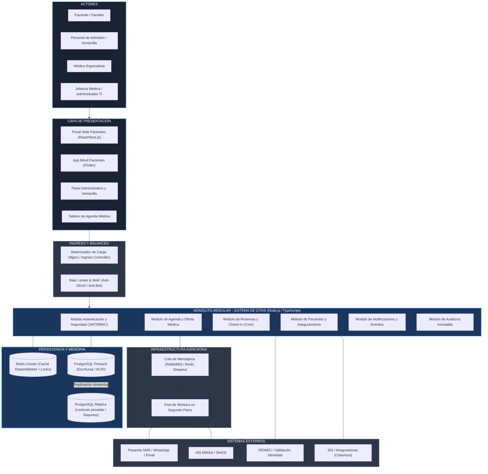

# Arquitectura Inicial del Sistema de Citas Médicas

## Diagrama de Arquitectura Global

## Descripción de las Capas

- **Capa de Presentación:** Múltiples clientes diseñados para sus respectivos perfiles:
  - *Portal Web y App Móvil:* Enfocados en la experiencia ágil del paciente para búsqueda rápida, agendamiento con pocos clics, recordatorios y check-in virtual.
  - *Panel Administrativo de Ventanilla:* Optimizado para velocidad de tipeo, búsqueda rápida de DNI y gestión de sobrecupos autorizados.
  - *Tablero del Médico:* Vista calendarizada y lista de pacientes en sala de espera en tiempo real.
- **Capa de Entrada y Balanceo:** 
  - Balanceador de carga Nginx / Ingress Controller distribuyendo el tráfico HTTP entre múltiples instancias réplica sin estado del servidor de aplicación.
  - Mecanismo de *Rate Limiting* para mitigar abusos, bots o scraping masivo durante la apertura de cupos médicos.
- **Capa de Lógica de Negocio (Monolito Modular):** 
  - Una sola aplicación estructurada internamente en módulos funcionales aislados mediante Arquitectura Hexagonal.
  - No existen llamadas de red HTTP entre los módulos; la comunicación interna ocurre mediante llamadas directas en memoria o despacho de eventos de dominio (`Domain Events`), eliminando latencias innecesarias.
- **Capa de Persistencia y Memoria:**
  - *Redis Clúster:* Almacena el catálogo de disponibilidad horaria (lecturas ultra rápidas < 15 ms) y orquesta los bloqueos distribuidos temporales de cupo (*slot locking*) para evitar doble reserva.
  - *PostgreSQL Primario:* Garantiza consistencia transaccional ACID estricta para la confirmación de citas y control de auditoría.
  - *PostgreSQL Réplica:* Atiende consultas de reportería estadística, métricas de inasistencia (*no-show*) y exportación sin degradar el rendimiento transaccional.
- **Capa de Mensajería Asíncrona (Workers):**
  - Desacopla las operaciones lentas o susceptibles a fallos de terceros (envíos de mensajes por WhatsApp/SMS, generación de PDFs de comprobante, sincronizaciones periódicas con el HIS MINSA).
- **Integraciones Externas:** Servicios de acreditación de identidad (RENIEC), verificación de aseguramiento (SIS) y plataformas de comunicación multicanal.
