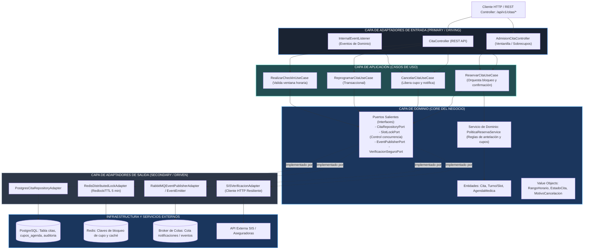

# Enfoque Arquitectónico

Dentro de la aplicación se aplica el enfoque de **Arquitectura Hexagonal (Puertos y Adaptadores)** combinada con **Clean Architecture** para cada módulo funcional (`citas`, `agenda`, `pacientes`, `notificaciones`). 

A continuación se detalla el enfoque tomando como referencia el módulo central de **Reservas y Citas Médicas** (ADR-002, ADR-003, ADR-008).

---

## Diagrama del Enfoque Hexagonal del Módulo de Citas

---

## Principios y Reglas del Enfoque

1. **Regla de Dependencia:** Las dependencias apuntan siempre hacia adentro. El **Dominio** no conoce los Controladores, ni PostgreSQL, ni Redis, ni librerías de terceros; solo define interfaces puras (*Puertos*).
2. **Aislamiento de Reglas de Negocio:** Las restricciones críticas de agendamiento (por ejemplo: *"un paciente no puede tener dos citas en la misma especialidad el mismo mes"*, *"un cupo no puede cancelarse con menos de 24 horas de antelación"*, *"el check-in solo es válido entre 45 y 10 minutos antes"*) residen exclusivamente en las entidades y servicios de dominio.
3. **Inversión de Control (IoC):** La capa de Infraestructura implementa los puertos definidos por el Dominio. Por ejemplo, el caso de uso interactúa con `SlotLockPort`; si mañana se migra de Redis a otro mecanismo de locking, la lógica de la reserva no sufre ninguna alteración.
4. **Resiliencia en Adaptadores Salientes:** Los adaptadores que consumen servicios externos (verificación SIS, pasarela de notificaciones) integran *Timeouts* estrictos y *Circuit Breakers* para evitar degradar el hilo de ejecución principal.
5. **Eventos de Dominio:** Cuando una cita es reservada, confirmada o cancelada, el caso de uso emite un evento (`CitaReservadaEvent`, `CitaCanceladaEvent`). Los submódulos de Notificaciones y Auditoría reaccionan a estos eventos sin acoplamiento directo entre el código de citas y el código de mensajería.
