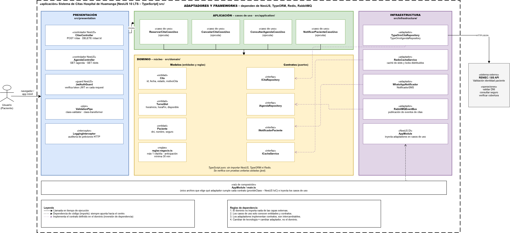

# Enfoque Arquitectónico

Se utiliza el enfoque **Clean Architecture (Arquitectura Limpia)** combinada con **Arquitectura Hexagonal (Puertos y Adaptadores)** para separar responsabilidades y aislar las reglas de negocio clínicas de la tecnología externa (ADR-002, ADR-008).

---

## Resumen del Enfoque

| Elemento | Descripción aplicada al Sistema de Citas Médicas |
| :--- | :--- |
| **Patrón / Enfoque Arquitectónico** | Clean Architecture (Arquitectura Limpia) y Puertos y Adaptadores. |
| **Objetivo** | Separar responsabilidades y controlar las dependencias estrictamente hacia el dominio clínico. |
| **¿Qué problema resuelve?** | Evita el acoplamiento entre los controladores HTTP (web/móvil), las reglas del negocio de salud y tecnologías externas como PostgreSQL, Redis, RabbitMQ y servicios web de RENIEC o SIS. |
| **Capas definidas** | Presentación, Aplicación, Dominio e Infraestructura. |
| **Beneficios** | • Facilita el mantenimiento y las pruebas unitarias aisladas en milisegundos. • Permite cambiar implementaciones técnicas (ej. motor de BD o pasarela de SMS) sin tocar las reglas del hospital. • Garantiza integridad transaccional y prevención absoluta de doble reserva. |

---

## Diagrama de Clean Architecture

---
