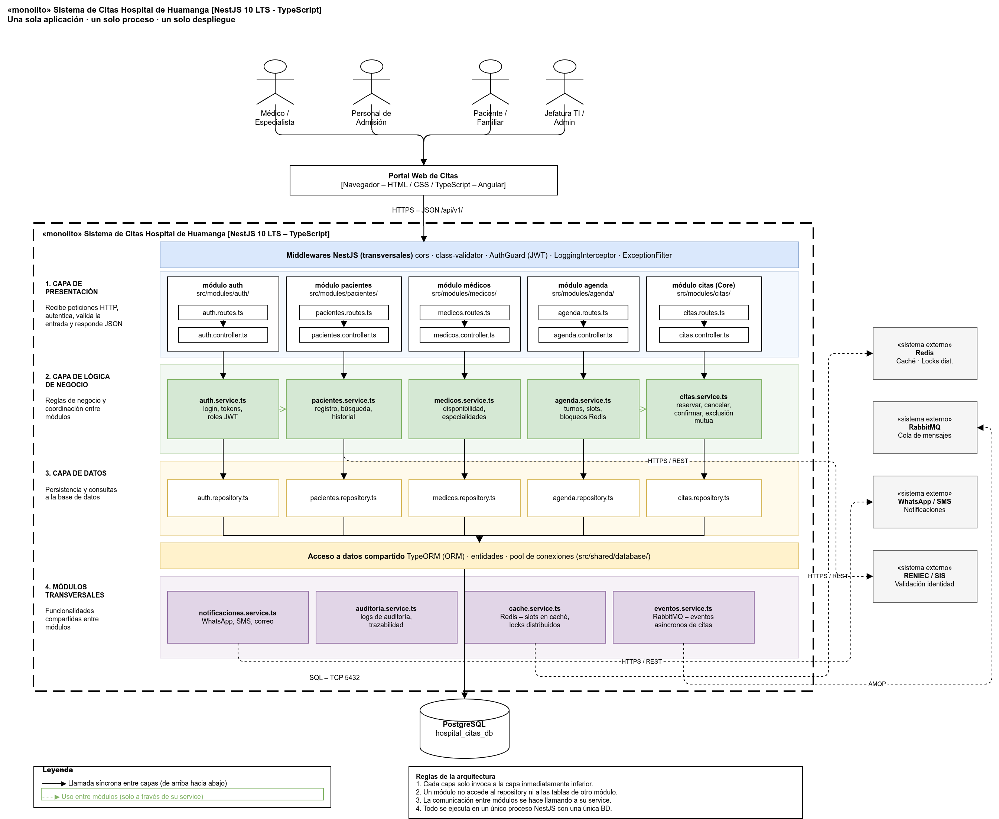

# Estilo Arquitectónico

Se utiliza el **estilo arquitectónico Monolítico Modular en Capas**, desplegado en instancias redundantes sin estado (*stateless*), complementado con **Caché en Memoria y Bloqueo Distribuido en Redis** y **Mensajería Asíncrona basada en Eventos**.

Esta decisión responde directamente a los drivers ADR-001, ADR-003, ADR-004, ADR-005 y ADR-007.

---

## Diagrama de Arquitectura Monolítica en Capas

---

## Metas de Disponibilidad y Recuperación

| Escenario de Falla | Estrategia de Mitigación | RTO (Tiempo de Recuperación) | RPO (Pérdida Máxima de Datos) |
| :--- | :--- | :--- | :--- |
| **Caída de una instancia de aplicación** | El balanceador Nginx detecta el fallo mediante `GET /health` y drena el tráfico a las réplicas restantes. El orquestador recrea el contenedor en segundos. | **< 3 segundos** | **0** (la aplicación es totalmente *stateless*) |
| **Pico masivo de solicitudes (Apertura 7:00 a. m.)** | Autoescalado horizontal de réplicas disparado por CPU > 70% o tasa de peticiones. Redis atiende el 90% de lecturas de disponibilidad. | **Automático (< 60 s)** | **0** |
| **Falla del nodo primario de PostgreSQL** | Activación y promoción automática de la réplica streaming standby mediante Patroni. | **< 30 segundos** | **≈ 0** (Replicación streaming síncrona en red local) |
| **Caída temporal de pasarela WhatsApp/SMS** | Los mensajes quedan retenidos en la cola RabbitMQ / Redis Streams y se reintentan progresivamente sin afectar la reserva de la cita. | **Inmediato (Aislado)** | **0** (Mensajería persistente con DLQ) |

---

## Justificación del Estilo

1. **Alineación con el Alcance Específico:** Al estar delimitado el sistema al módulo de citas médicas, un enfoque de microservicios añadiría capas de red artificiales. El monolito modular ejecuta las validaciones y reglas entre submódulos en **nanosegundos en memoria**, maximizando la velocidad.
2. **Control Estricto de Concurrencia:** La reserva de un cupo médico exige exclusión mutua para evitar sobreventa. Gestionar esto en una base de datos relacional con bloqueo pesimista y locks de Redis es simple, auditable y robusto en un monolito modular.
3. **Escalabilidad Elástica a Bajo Costo:** Dado que el monolito es *stateless*, escalar de 2 a 10 réplicas durante los 30 minutos de apertura de agenda es sumamente económico y sencillo de orquestar.
4. **Desacoplamiento Preparado para el Futuro:** Si en etapas posteriores el hospital decide incorporar otros módulos de gran envergadura (como Triaje o Historia Clínica Completa), los límites hexagonales del módulo de citas permitirán exponerlo externamente como un microservicio independiente sin reescribir su lógica interna.
