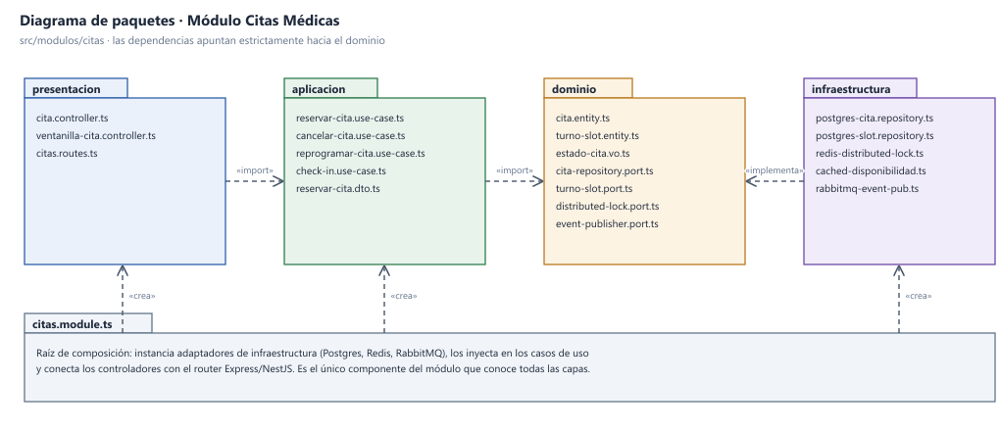
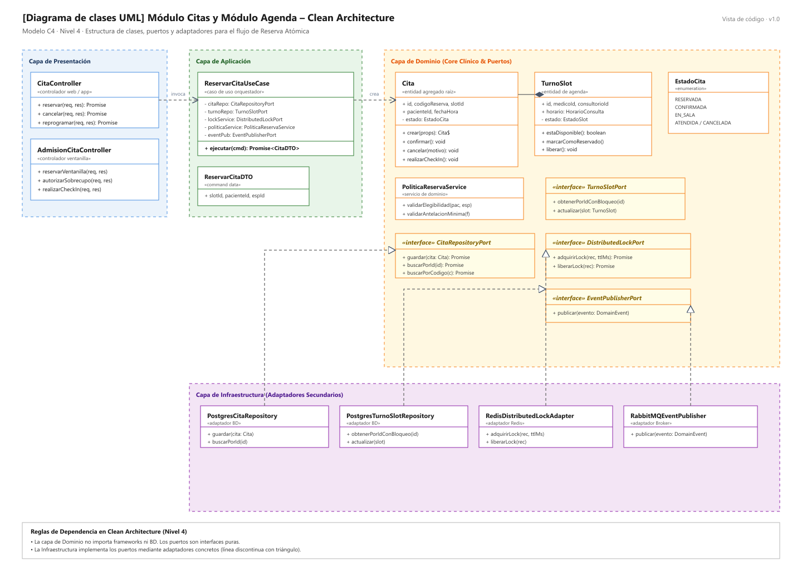
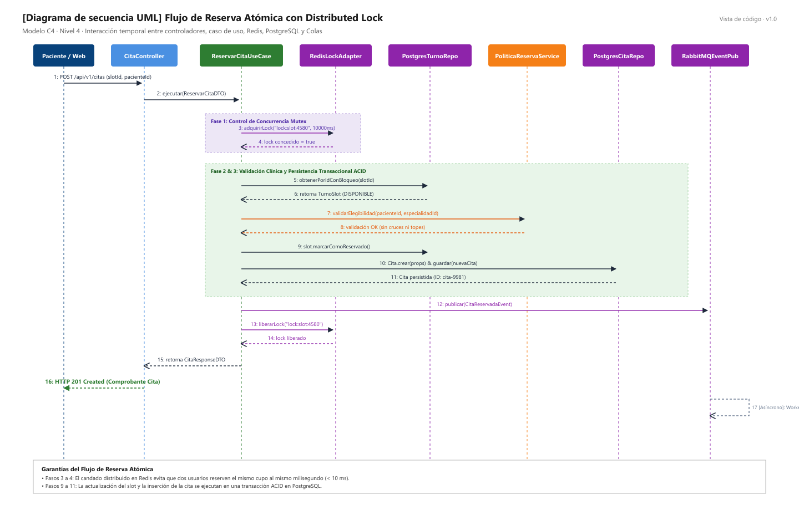

# Diseño Interno de Módulos

> **Proyecto:** Sistema de Citas Médicas Escalable · Hospital de Huamanga  
> **Backend:** Node.js + TypeScript (NestJS / Express) · **Módulo de referencia:** Citas Médicas (`src/modulos/citas/`)  
> **Enfoque arquitectónico:** Clean Architecture dentro de cada módulo del monolito modular (ADR-001, ADR-002, ADR-008)  
> **Nivel C4:** 4 – Código · **Versión:** 1.0

---

## 1. Propósito

Este documento describe **cómo se organiza el código dentro de un módulo** del backend del sistema hospitalario. Tiene tres objetivos fundamentales:
- Que todos los módulos se construyan bajo la misma estructura física y lógica homogénea.
- Que las reglas de negocio clínicas (topes, antelación, estados de cupo) queden aisladas de la tecnología externa.
- Que cualquier integrante del equipo sepa dónde va cada archivo y de qué puede depender.

---

## 2. Estructura de Carpetas

```text
src/
└── modulos/
    └── citas/                                       # Módulo Núcleo de Citas Médicas
        ├── dominio/
        │   ├── cita.entity.ts                       # Entidad Cita y sus reglas de estado
        │   ├── turno-slot.entity.ts                 # Entidad Cupo/Slot horario
        │   ├── estado-cita.vo.ts                    # Enum EstadoCita (RESERVADA, CONFIRMADA...)
        │   ├── horario-consulta.vo.ts               # Value Object RangoHorario
        │   ├── codigo-reserva.vo.ts                 # Value Object Identificador Único
        │   ├── politica-reserva.service.ts          # Servicio de Dominio (reglas complejas)
        │   ├── cita-repository.port.ts              # Interfaz (puerto) de persistencia de citas
        │   ├── turno-slot.port.ts                   # Interfaz (puerto) de lectura/bloqueo de slots
        │   ├── distributed-lock.port.ts             # Interfaz (puerto) de bloqueo anti-doble reserva
        │   └── event-publisher.port.ts              # Interfaz (puerto) para publicar eventos
        ├── aplicacion/
        │   ├── reservar-cita.use-case.ts            # Caso de uso: orquestación de reserva atómica
        │   ├── cancelar-cita.use-case.ts            # Caso de uso: cancelación y liberación
        │   ├── reprogramar-cita.use-case.ts         # Caso de uso: cambio de turno
        │   ├── check-in.use-case.ts                 # Caso de uso: confirmación de asistencia en sala
        │   └── dtos/
        │       ├── reservar-cita.dto.ts             # Datos de entrada validados
        │       └── cita-response.dto.ts             # DTO de respuesta al cliente
        ├── infraestructura/
        │   ├── postgres-cita.repository.ts          # Implementación con PostgreSQL (ACID)
        │   ├── postgres-turno-slot.repository.ts    # Implementación con PostgreSQL (SELECT FOR UPDATE)
        │   ├── redis-distributed-lock.ts            # Implementación con Redis (Set NX PX)
        │   ├── cached-disponibilidad.ts             # Decorator con Redis para lectura rápida
        │   └── rabbitmq-event-publisher.ts          # Publicador al broker de eventos RabbitMQ
        ├── presentacion/
        │   ├── cita.controller.ts                   # Controlador HTTP REST para portal y app
        │   ├── ventanilla-cita.controller.ts        # Controlador optimizado para admisión
        │   └── citas.routes.ts                      # Definición de rutas /api/v1/citas
        ├── citas.module.ts                          # Raíz de composición del módulo (IoC)
        └── index.ts                                 # API pública del módulo hacia otros módulos
```

| Archivo | Capa | Responsabilidad | Importa de |
| :--- | :--- | :--- | :--- |
| `cita.entity.ts` | Dominio | Crear citas válidas, confirmar, cancelar y cambiar estado | Solo dominio |
| `turno-slot.entity.ts` | Dominio | Representar el cupo horario médico y verificar disponibilidad | Solo dominio |
| `estado-cita.vo.ts` | Dominio | Definir los estados válidos de la cita médica | Nada |
| `cita-repository.port.ts`| Dominio | Declarar **qué** operaciones de persistencia necesita el módulo | `cita.entity.ts` |
| `distributed-lock.port.ts`| Dominio | Declarar **qué** necesita el módulo para exclusión mutua de cupos | Primitivas |
| `event-publisher.port.ts`| Dominio | Declarar **qué** necesita para publicar eventos de dominio | Eventos |
| `reservar-cita.use-case.ts`| Aplicación | Coordinar los pasos de la reserva atómica | Dominio |
| `reservar-cita.dto.ts` | Aplicación | Datos de entrada validados del caso de uso | Nada |
| `postgres-cita.repository.ts`| Infraestructura | Guardar y leer citas en PostgreSQL | Dominio + driver de BD |
| `redis-distributed-lock.ts` | Infraestructura | Implementar candado distribuido con Redis (`SET NX PX`) | Dominio + cliente Redis |
| `cita.controller.ts` | Presentación | Recibir la petición HTTP, invocar el caso de uso y responder | Aplicación |
| `citas.routes.ts` | Presentación | Registrar las rutas en el router web | Presentación |
| `citas.module.ts` | Composición | Instanciar adaptadores concretos e inyectarlos | Todas las capas |
| `index.ts` | Composición | Exponer solo lo que otros módulos pueden usar | `citas.module.ts` |

---

## 3. Capas del Módulo y Regla de Dependencia




**Regla de Dependencia:** El código solo puede importar hacia el centro (dominio). El dominio no conoce Express, PostgreSQL, Redis ni RabbitMQ.

| Capa | Contiene | Responsabilidad | Puede depender de | **No** puede depender de |
| :--- | :--- | :--- | :--- | :--- |
| **Dominio** | Entidades, objetos de valor, enumeraciones, interfaces (puertos) | Reglas de negocio del hospital que serían ciertas con cualquier tecnología | Nada externo | Aplicación, infraestructura, presentación, Express, ORM, SDKs |
| **Aplicación** | Casos de uso, comandos DTO | Orquestar el flujo: qué paso va primero y qué hacer si falla | Dominio | Infraestructura, presentación, Express, ORM |
| **Infraestructura** | Repositorios concretos, adaptadores de Redis, brokers | Implementar las interfaces del dominio con tecnologías concretas | Dominio, librerías externas | Aplicación, presentación |
| **Presentación** | Controladores, rutas | Traducir HTTP a llamadas del caso de uso y viceversa | Aplicación | Infraestructura, base de datos |
| **Composición** | `citas.module.ts` | Elegir implementaciones concretas y conectarlas | Todas | — |

---

## 4. Diagrama de Clases



### Notación UML Utilizada

| Símbolo | Significado | Ejemplo en el diagrama |
| :--- | :--- | :--- |
| Línea continua con flecha abierta | Asociación: la clase guarda una referencia a la otra | `ReservarCitaUseCase` → `CitaRepositoryPort` |
| Línea discontinua con flecha abierta | Dependencia: la usa o la crea temporalmente | `CitaController` «invoca» `ReservarCitaUseCase` |
| Línea discontinua con triángulo hueco | Realización: implementa una interfaz | `PostgresCitaRepository` ▷ `CitaRepositoryPort` |
| Rombo relleno | Composición: la parte no existe sin el todo | `Cita` ◆ `CodigoReserva` |
| Nombre en cursiva + «interface» | Interfaz (contrato sin implementación) | `CitaRepositoryPort`, `DistributedLockPort` |
| `-` / `+` | Privado / público | `- estado`, `+ confirmar()` |

---

## 5. Flujo de Ejecución: Reservar Cita Médica



| Paso | Origen → Destino | Acción Realizada | Capa |
| :--- | :--- | :--- | :--- |
| 1 | Paciente Web → `CitaController` | `POST /api/v1/citas` con `slotId`, `pacienteId`, `especialidadId` | Presentación |
| 2 | `CitaController` → `ReservarCitaUseCase` | `ejecutar(command)` | Presentación → Aplicación |
| 3 | `ReservarCitaUseCase` → `RedisDistributedLock` | `adquirirLock("lock:slot:4580", 10000)` para exclusión mutua | Aplicación → Infraestructura |
| 4 | `RedisDistributedLock` → `ReservarCitaUseCase` | Candado concedido (si otro usuario compite, recibe 409 Conflict) | Infraestructura → Aplicación |
| 5–6 | `ReservarCitaUseCase` → `PostgresTurnoSlotRepo` | `obtenerPorIdConBloqueo(slotId)`; verifica que esté DISPONIBLE | Aplicación → Infraestructura |
| 7–8 | `ReservarCitaUseCase` → `PoliticaReservaService`| `validarElegibilidad(pacienteId, especialidadId)` (sin cruces de horario) | Aplicación → Dominio |
| 9 | `ReservarCitaUseCase` → `TurnoSlot` | `marcarComoReservado()` | Aplicación → Dominio |
| 10–11 | `ReservarCitaUseCase` → `PostgresCitaRepo` | Guarda la entidad `Cita` en PostgreSQL bajo transacción ACID | Aplicación → Infraestructura |
| 12 | `ReservarCitaUseCase` → `RabbitMQEventPublisher`| Publica `CitaReservadaEvent` en broker para notificaciones | Aplicación → Infraestructura |
| 13–14 | `ReservarCitaUseCase` → `RedisDistributedLock` | `liberarLock("lock:slot:4580")` | Aplicación → Infraestructura |
| 15–16 | `CitaController` → Paciente Web | Responde `201 Created` con código y comprobante digital (< 500 ms) | Presentación |
| 17 | `RabbitMQEventPublisher` → Workers | En segundo plano, los workers despachan WhatsApp y sincronizan MINSA | Infraestructura asíncrona |

---

## 6. Código de Referencia

### 6.1 Dominio · Entidad e Interfaces

```typescript
// src/modulos/citas/dominio/cita.entity.ts
import { EstadoCita } from './estado-cita.vo';
import { CodigoReserva } from './codigo-reserva.vo';
import { ReglaNegocioError } from '../../../shared/errores';

export class Cita {
  private constructor(
    readonly id: string,
    readonly codigoReserva: CodigoReserva,
    readonly pacienteId: string,
    readonly slotId: string,
    readonly medicoId: string,
    readonly especialidadId: string,
    readonly fechaHoraInicio: Date,
    private estado: EstadoCita,
  ) {}

  static crear(props: {
    pacienteId: string;
    slotId: string;
    medicoId: string;
    especialidadId: string;
    fechaHoraInicio: Date;
  }): Cita {
    if (!props.pacienteId) throw new ReglaNegocioError('RN-01: La cita requiere un paciente válido.');
    if (!props.slotId) throw new ReglaNegocioError('RN-02: La cita requiere un cupo horario (slot).');

    const codigo = CodigoReserva.generarAleatorio();
    return new Cita(
      crypto.randomUUID(),
      codigo,
      props.pacienteId,
      props.slotId,
      props.medicoId,
      props.especialidadId,
      props.fechaHoraInicio,
      EstadoCita.RESERVADA,
    );
  }

  confirmar(): void {
    if (this.estado !== EstadoCita.RESERVADA) {
      throw new ReglaNegocioError('Solo una cita en estado RESERVADA puede confirmarse.');
    }
    this.estado = EstadoCita.CONFIRMADA;
  }

  cancelar(motivo: string): void {
    if (this.estado === EstadoCita.ATENDIDA) {
      throw new ReglaNegocioError('Una cita ya atendida no puede cancelarse.');
    }
    this.estado = EstadoCita.CANCELADA;
  }

  realizarCheckIn(): void {
    if (this.estado !== EstadoCita.CONFIRMADA && this.estado !== EstadoCita.RESERVADA) {
      throw new ReglaNegocioError('No se puede realizar check-in a una cita inactiva o cancelada.');
    }
    this.estado = EstadoCita.EN_SALA;
  }
}
```

```typescript
// src/modulos/citas/dominio/cita-repository.port.ts
import { Cita } from './cita.entity';

export interface CitaRepositoryPort {
  guardar(cita: Cita): Promise<Cita>;
  buscarPorId(id: string): Promise<Cita | null>;
  buscarPorCodigo(codigo: string): Promise<Cita | null>;
}
```

```typescript
// src/modulos/citas/dominio/distributed-lock.port.ts
export interface DistributedLockPort {
  adquirirLock(recurso: string, ttlMs: number): Promise<boolean>;
  liberarLock(recurso: string): Promise<void>;
}
```

### 6.2 Aplicación · Caso de Uso Orquestador

```typescript
// src/modulos/citas/aplicacion/reservar-cita.use-case.ts
import { Cita } from '../dominio/cita.entity';
import { CitaRepositoryPort } from '../dominio/cita-repository.port';
import { TurnoSlotPort } from '../dominio/turno-slot.port';
import { DistributedLockPort } from '../dominio/distributed-lock.port';
import { EventPublisherPort } from '../dominio/event-publisher.port';
import { PoliticaReservaService } from '../dominio/politica-reserva.service';
import { ReservarCitaDTO } from './dtos/reservar-cita.dto';
import { CitaResponseDTO } from './dtos/cita-response.dto';
import { ConflictoReservaError, SlotNoDisponibleError } from '../../../shared/errores';

export class ReservarCitaUseCase {
  constructor(
    private readonly citaRepo: CitaRepositoryPort,
    private readonly turnoRepo: TurnoSlotPort,
    private readonly lockService: DistributedLockPort,
    private readonly politicaService: PoliticaReservaService,
    private readonly eventPublisher: EventPublisherPort,
  ) {}

  async ejecutar(command: ReservarCitaDTO): Promise<CitaResponseDTO> {
    const lockKey = `lock:slot:${command.slotId}`;

    // 1. Candado atómico en Redis (TTL 10s)
    const lockAdquirido = await this.lockService.adquirirLock(lockKey, 10000);
    if (!lockAdquirido) {
      throw new ConflictoReservaError('El horario seleccionado está siendo reservado por otro usuario.');
    }

    try {
      // 2. Verificar disponibilidad del cupo con bloqueo pesimista en SQL
      const slot = await this.turnoRepo.obtenerPorIdConBloqueo(command.slotId);
      if (!slot.estaDisponible()) {
        throw new SlotNoDisponibleError('El cupo seleccionado ya no se encuentra libre.');
      }

      // 3. Evaluar reglas de dominio
      await this.politicaService.validarElegibilidad(command.pacienteId, slot.especialidadId);

      // 4. Crear entidad de Cita
      const nuevaCita = Cita.crear({
        pacienteId: command.pacienteId,
        slotId: slot.id,
        medicoId: slot.medicoId,
        especialidadId: slot.especialidadId,
        fechaHoraInicio: slot.fechaHoraInicio,
      });

      // 5. Persistencia atómica
      slot.marcarComoReservado();
      await this.turnoRepo.actualizar(slot);
      const citaGuardada = await this.citaRepo.guardar(nuevaCita);

      // 6. Publicación asíncrona de evento de dominio
      await this.eventPublisher.publicar({
        tipo: 'CitaReservadaEvent',
        payload: { citaId: citaGuardada.id, codigo: citaGuardada.codigoReserva.valor },
      });

      return {
        citaId: citaGuardada.id,
        codigoReserva: citaGuardada.codigoReserva.valor,
        estado: 'RESERVADA',
      };
    } finally {
      // 7. Liberar candado garantizado
      await this.lockService.liberarLock(lockKey);
    }
  }
}
```
