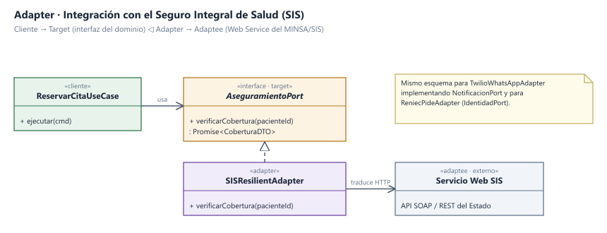

# Patrones de Diseño

## Objetivo

Documentar los patrones de diseño aplicados en el backend del **Sistema de Citas Médicas**, indicando en qué capa se aplican, qué problema concreto resuelven y con qué tecnología se implementan, para que el equipo programe de forma uniforme.

---

## Contexto

- **Estilo:** Monolito modular (Node.js + NestJS / TypeScript).
- **Enfoque interno:** Clean Architecture y Arquitectura Hexagonal.
- **Base:** Diagrama de componentes (C4 Nivel 3).

---

## Patrones Aplicados

| Patrón | Dónde se usa | Problema que resuelve | Se implementa con | Elementos del diseño |
| :--- | :--- | :--- | :--- | :--- |
| **Adapter** | Pacientes / Citas → SIS &amp; RENIEC | Cada entidad estatal tiene su propia interfaz (SOAP/REST) | Clientes HTTP con Circuit Breaker | `AseguramientoPort`, `SISResilientAdapter` |
| **Adapter** | Citas → Pasarela de Notificaciones | El proveedor de mensajería (WhatsApp/SMS) puede cambiar | SDK Meta / Twilio | `NotificacionPort`, `WhatsAppCloudAdapter` |
| **Repository** | Todos los módulos → Base de datos | El dominio no debe conocer SQL ni acoplarse al ORM | PostgreSQL con TypeORM / Kysely | `CitaRepositoryPort`, `PostgresCitaRepository` |
| **Distributed Lock (Mutex)** | Citas → Redis Clúster | Prevenir sobreventa de cupos (*zero double-booking*) en ráfagas de apertura | Primitivas atómicas `SET NX PX` en Redis | `DistributedLockPort`, `RedisDistributedLockAdapter` |
| **Decorator** | Agenda → Caché en memoria | Responder en menos de 15 ms a consultas masivas de cupos libres | Redis Clúster con TTL | `CachedDisponibilidadDecorator` envolviendo repositorio |
| **Domain Events (Pub/Sub)** | Módulo Citas → Notificaciones &amp; Auditoría | Desacoplar la confirmación de la cita del envío de mensajes | RabbitMQ / EventEmitter2 | `CitaReservadaEvent`, `NotificacionesListener` |
| **Circuit Breaker** | Adaptadores de sistemas externos | La caída del SIS o RENIEC no debe bloquear la reserva en ventanilla | Librería *Opossum* | Fallback condicional en `SISResilientAdapter` |

---

## Diagrama del Patrón Adapter (Integración SIS)

---

## Cómo Funciona Cada Patrón

| Patrón | En pocas palabras |
| :--- | :--- |
| **Adapter** | Traduce: el caso de uso dice `verificarCobertura(pacienteId)` y el adaptador lo convierte en la llamada HTTPS propia del SIS o de la aseguradora. |
| **Repository** | El negocio dice `guardar(cita)`; el repositorio escribe y ejecuta el SQL en PostgreSQL. |
| **Distributed Lock** | Cuando un usuario intenta reservar el cupo `slot-4580`, solicita un candado en Redis por 10 segundos. Si otro usuario envía la petición en el mismo milisegundo, Redis responde `NIL` y se devuelve `HTTP 409 Conflict`. |
| **Decorator** | Busca primero en Redis; si hay *Cache Hit*, retorna de inmediato. Si no está, consulta PostgreSQL y lo guarda en Redis con TTL de 60 segundos. |
| **Domain Events** | Al confirmarse la cita, se emite el evento `CitaReservadaEvent`. El módulo de notificaciones lo toma de la cola y envía el WhatsApp sin demorar la respuesta web. |

---

## Beneficios Obtenidos

- Cambiar el proveedor de WhatsApp/SMS o el motor de base de datos solo afecta a su adaptador específico.
- La caché en Redis se puede purgar, reiniciar o retirar sin tocar una sola regla de negocio de citas.
- Nuevos módulos (como Triaje o Farmacia) pueden reaccionar a la reserva suscribiéndose a eventos sin modificar el código de Citas.
