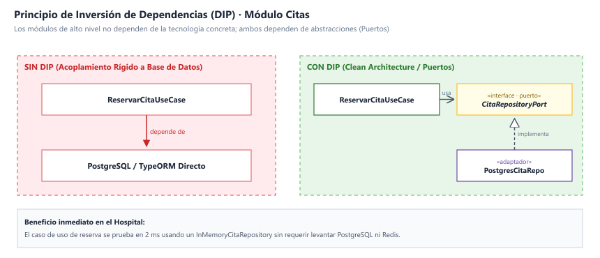

# Principios de Diseño (SOLID)

## Objetivo

Documentar cómo se aplican los principios SOLID en el backend del **Sistema de Citas Médicas**, organizado bajo Clean Architecture, para que cada módulo se programe de forma uniforme y las reglas clínicas no dependan de la tecnología.

---

## Contexto

- **Estilo:** Monolito modular (Node.js + NestJS / TypeScript).
- **Enfoque interno:** Clean Architecture (Presentación, Aplicación, Dominio e Infraestructura).
- **Módulo de referencia:** Citas Médicas (`src/modulos/citas`), por integrar persistencia transaccional, bloqueos distribuidos y servicios externos.

---

## SOLID en el Módulo de Citas

| Principio | Dónde se aplica (Capa) | Cómo se cumple en el Sistema de Citas | Archivos de Ejemplo |
| :--- | :--- | :--- | :--- |
| **S** · Responsabilidad Única | Todas las capas | Cada clase tiene una sola razón de cambio: el controlador solo mapea HTTP, el caso de uso solo orquesta la reserva, la entidad `Cita` solo valida estados clínicos y el repositorio solo escribe SQL. | `cita.controller.ts`, `reservar-cita.use-case.ts`, `cita.entity.ts`, `postgres-cita.repository.ts` |
| **O** · Abierto/Cerrado | Infraestructura | Para incorporar un nuevo canal de notificación (ej. WhatsApp Business API oficial) se crea un nuevo adaptador que implementa `NotificacionPort`, sin modificar el caso de uso de reserva. | `whatsapp-cloud.adapter.ts`, `twilio-sms.adapter.ts` |
| **L** · Sustitución de Liskov | Infraestructura | `PostgresDisponibilidadRepo` y `CachedDisponibilidadDecorator` implementan el mismo contrato `DisponibilidadPort`. El caso de uso funciona idénticamente con cualquiera. | `disponibilidad.port.ts`, `cached-disponibilidad.ts` |
| **I** · Segregación de Interfaces | Dominio (Puertos) | Cada interfaz expone solo lo que el consumidor necesita: `DistributedLockPort` solo adquiere y libera candados; `EventPublisherPort` solo publica eventos; `CitaRepositoryPort` solo gestiona persistencia de citas. | `distributed-lock.port.ts`, `event-publisher.port.ts`, `cita-repository.port.ts` |
| **D** · Inversión de Dependencias | Aplicación | El caso de uso recibe interfaces por constructor y no conoce PostgreSQL, Redis ni RabbitMQ. Las implementaciones se inyectan en `citas.module.ts`. | `reservar-cita.use-case.ts`, `citas.module.ts` |

---

## Qué Pasaría Sin SOLID en el Sistema de Citas

| Situación Real | Sin SOLID | Con SOLID |
| :--- | :--- | :--- |
| **Se cambia de pasarela de mensajería (SMS → WhatsApp API)** | Hay que modificar controladores y casos de uso donde existían llamadas directas a axios. | Solo se crea `WhatsAppAdapter implements NotificacionPort`. El caso de uso no se toca. |
| **Pico de apertura mensual satura la base de datos** | La consulta de cupos está ligada al controlador mediante consultas SQL directas; no hay forma limpia de colocar Redis sin reescribir todo. | Se envuelve el repositorio con un *Decorator* de Redis (`CachedDisponibilidadDecorator`). El caso de uso ni siquiera se entera del cambio. |
| **Se quiere probar la reserva de citas bajo alta carga** | Se necesita tener levantada una base de datos PostgreSQL real y conexión activa al SIS. | Se prueba con implementaciones en memoria (`InMemoryCitaRepository`, `MockLockService`) en 2 ms. |
| **Cambia la regla hospitalaria de cancelación (de 24h a 12h)** | La validación está dispersa y duplicada en la pantalla web, en el backend y en procedimientos de BD. | La regla vive centralizada en la entidad `Cita.validarPuedeCancelar()`. |

---

## Relación con Clean Architecture y los Patrones

| Principio | Lo cumple en el proyecto |
| :--- | :--- |
| **Responsabilidad Única** | La separación estricta en 4 capas concéntricas (ADR-002, ADR-008). |
| **Abierto/Cerrado y Liskov** | Los patrones Adapter (SIS, WhatsApp) y Decorator (Redis caché). |
| **Segregación de Interfaces** | Los puertos pequeños y específicos del dominio (`DistributedLockPort`, `CitaRepositoryPort`). |
| **Inversión de Dependencias** | El patrón Repository y la regla de que la infraestructura depende del dominio. |
