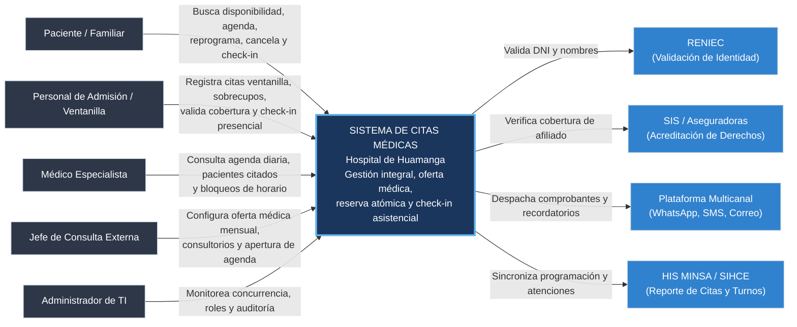

# Nivel 1 · Diagrama de Contexto del Sistema

> **Proyecto:** Sistema de Citas Médicas Escalable · Hospital de Huamanga  
> **Modelo:** C4 · Nivel 1 de 4

---

## 1. Objetivo

Mostrar el **Sistema de Citas Médicas como una sola caja**: quiénes interactúan directamente con él (usuarios humanos) y con qué sistemas o plataformas externas se comunica. Proporciona la perspectiva global sin entrar en detalles tecnológicos ni bases de datos.

| Aspecto | Descripción |
| :--- | :--- |
| **Pregunta que responde** | ¿Qué es el sistema de citas, quién lo utiliza y con qué servicios externos interactúa? |
| **Audiencia** | Dirección Hospitalaria, Jefatura de Consulta Externa, Personal de Admisión, Equipo de Desarrollo y TI |
| **Qué NO muestra** | Tecnologías, contenedores, base de datos ni estructura interna de código |
| **Siguiente nivel** | [`Nivel2-DiagramadeContenedores.md`](Nivel2-DiagramadeContenedores.md) |

---

## 2. Diagrama de Contexto

---

## 3. Personas (Usuarios del Sistema)

| Persona | Tipo | Descripción | Qué hace en el sistema |
| :--- | :--- | :--- | :--- |
| **Paciente / Familiar** | Externo | Usuario del hospital o apoderado registrado | Busca turnos libres, agenda citas médicas, cancela o reprograma con antelación, realiza check-in virtual y recibe comprobantes y recordatorios por WhatsApp/SMS. |
| **Personal de Admisión** | Interno | Operador en ventanillas de consulta externa | Registra citas a pacientes presenciales o vía telefónica, realiza check-in presencial, valida acreditación y asigna sobrecupos autorizados. |
| **Médico Especialista** | Interno | Profesional médico del hospital | Consulta su agenda del día y semana, verifica pacientes confirmados en sala de espera y gestiona bloqueos de turno por contingencia. |
| **Jefe de Consulta Externa** | Interno | Coordinador médico de servicios ambulatorios | Asigna turnos, médicos y consultorios físicos a la programación mensual; determina la fecha/hora de apertura de la agenda pública. |
| **Administrador de TI** | Interno | Personal técnico de sistemas | Administra credenciales y roles (RBAC), supervisa métricas de carga en picos y audita el historial de transacciones. |

---

## 4. Sistemas Externos

| Sistema | Responsabilidad | Interacción con el Sistema de Citas |
| :--- | :--- | :--- |
| **RENIEC** | Registro Nacional de Identificación y Estado Civil | Provee la consulta en línea para verificar autenticidad de DNI y autocompletar apellidos y nombres de nuevos pacientes. |
| **SIS / Aseguradoras** | Plataforma de acreditación sanitaria | Valida si el paciente cuenta con afiliación activa al Seguro Integral de Salud o EPS para determinar la cobertura del cupo. |
| **Plataforma Multicanal** | Proveedor de mensajería (WhatsApp Cloud API / SMS / SendGrid) | Envía el comprobante digital de la reserva, códigos OTP y recordatorios automáticos (24h y 2h antes de la cita). |
| **HIS MINSA / SIHCE** | Sistema Nacional de Información en Salud del MINSA | Recibe la consolidación de turnos médicos y estadísticas de citas programadas para interoperabilidad sanitaria nacional. |

---

## 5. Relaciones y Protocolos

| Origen | Destino | Descripción | Protocolo / Canal |
| :--- | :--- | :--- | :--- |
| Paciente / Personal | Sistema | Interacción con la interfaz web y móvil | HTTPS / TLS 1.3 (JSON REST API) |
| Sistema | RENIEC | Validación de datos filiatorios | HTTPS / REST (Servicio PIDE) |
| Sistema | SIS | Verificación de acreditación de cobertura | HTTPS / REST / SOAP |
| Sistema | Plataforma Multicanal | Encolamiento y despacho de mensajes de recordatorio | HTTPS / REST (Asíncrono vía colas) |
| Sistema | HIS MINSA | Envío de reportes de atenciones y turnos | HTTPS con estándar HL7 FHIR |

---

## 6. Supuestos y Decisiones de Contexto

1. **Aislamiento del Core de Citas:** Las fallas temporales en RENIEC o SIS no detienen la reserva; el sistema permite confirmar la cita bajo estado condicional para su regularización física en ventanilla.
2. **Protección de Datos:** Toda consulta y transmisión de datos de pacientes cumple con la Ley N.° 29733 (datos sensibles de salud).
3. **Escalabilidad en la Frontera:** El sistema absorbe el pico masivo de las 7:00 a.m. sin depender de la velocidad de respuesta de sistemas externos.
