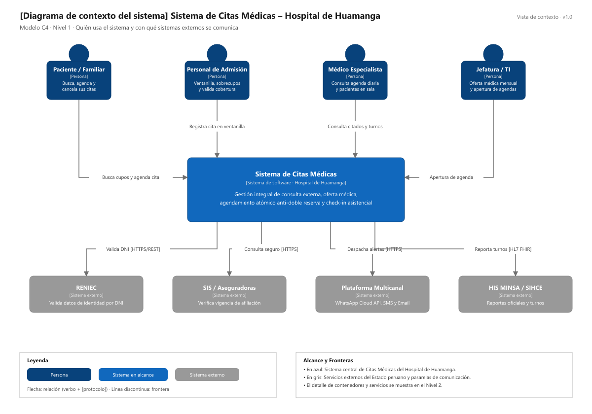

# Nivel 1 · Diagrama de Contexto del Sistema

> **Proyecto:** Sistema de Citas Médicas Escalable · Hospital de Huamanga  
> **Modelo:** C4 · Nivel 1 de 4 · **Versión:** 1.0

---

## 1. Objetivo

Mostrar el **Sistema de Citas Médicas como una sola caja**: quiénes lo usan (usuarios humanos) y con qué sistemas externos se comunica. Es la vista de mayor nivel y la primera que se presenta a cualquier persona, técnica o directiva.

| Aspecto | Descripción |
| :--- | :--- |
| **Pregunta que responde** | ¿Qué es el sistema de citas, quién lo usa y con qué servicios externos se integra? |
| **Audiencia** | Dirección Hospitalaria, Jefatura de Consulta Externa, Personal de Admisión, Equipo de Desarrollo y TI |
| **Qué NO muestra** | Tecnologías, servidores, bases de datos ni módulos internos |
| **Siguiente nivel** | [`Nivel2-DiagramadeContenedores.md`](Nivel2-DiagramadeContenedores.md) |

---

## 2. Diagrama

---

## 3. Personas (Usuarios)

| Persona | Descripción | Qué hace en el sistema |
| :--- | :--- | :--- |
| **Paciente / Familiar** | Usuario ambulatorio o apoderado registrado | Busca turnos libres por especialidad y médico, agenda citas, reprograma o cancela con antelación, realiza check-in virtual y recibe recordatorios. |
| **Personal de Admisión** | Operador en ventanillas de consulta externa | Registra citas para pacientes presenciales o vía telefónica, realiza check-in presencial, valida acreditación y asigna sobrecupos autorizados. |
| **Médico Especialista** | Profesional médico del hospital | Consulta su agenda diaria y semanal, verifica la lista de pacientes citados y en sala de espera, y gestiona bloqueos de horario por contingencia. |
| **Jefatura de Consulta / TI**| Coordinación médica y administradores de sistemas | Configura la oferta médica mensual (cupos, consultorios físicos y horarios de atención), calendariza la apertura pública de agendas y audita accesos. |

---

## 4. Sistemas Externos

| Sistema | Tipo | Responsabilidad | Quién lo administra |
| :--- | :--- | :--- | :--- |
| **Sistema de Citas Médicas** | Sistema en alcance | Gestión integral de oferta médica, catálogo de disponibilidad, agendamiento atómico anti-doble reserva y check-in asistencial | Equipo del proyecto |
| **RENIEC** | Sistema externo | Valida en línea la autenticidad del Documento Nacional de Identidad (DNI) y datos filiatorios | RENIEC / Plataforma PIDE |
| **SIS / Aseguradoras** | Sistema externo | Verifica acreditación y derechos de cobertura sanitaria del paciente | Seguro Integral de Salud / EPS |
| **Plataforma Multicanal** | Sistema externo | Despacha comprobantes de cita, recordatorios (24h y 2h antes) y alertas | Meta WhatsApp Cloud API / Twilio |
| **HIS MINSA / SIHCE** | Sistema externo | Recibe el reporte diario de programación de turnos y atenciones médicas | Ministerio de Salud (MINSA) |

---

## 5. Relaciones

| Origen | Destino | Descripción | Protocolo |
| :--- | :--- | :--- | :--- |
| Paciente / Familiar | Sistema de Citas | Busca disponibilidad, agenda, reprograma y check-in | — |
| Personal de Admisión | Sistema de Citas | Gestiona citas en ventanilla y valida afiliación | — |
| Médico Especialista | Sistema de Citas | Consulta agenda de pacientes y bloquea turnos | — |
| Jefatura / TI | Sistema de Citas | Publica oferta médica y apertura de agendas | — |
| Sistema de Citas | RENIEC | Valida datos de filiación y DNI | HTTPS/REST |
| Sistema de Citas | SIS / Aseguradoras | Consulta acreditación de cobertura médica | HTTPS/REST |
| Sistema de Citas | Plataforma Multicanal | Encola y despacha confirmaciones y recordatorios | HTTPS/REST (Asíncrono) |
| Sistema de Citas | HIS MINSA / SIHCE | Reporta consolidado de atenciones y turnos | HTTPS / HL7 FHIR |

> En el nivel 1 no se detalla el protocolo de red entre usuarios y pantallas; eso se especifica en el nivel 2.

---

## 6. Decisiones y Supuestos

| # | Decisión o Supuesto | Motivo |
| :--- | :--- | :--- |
| 1 | Las integraciones con el SIS y RENIEC son no bloqueantes | Si los servicios estatales demoran o caen, la cita se registra en estado condicional para no degradar la reserva del paciente (ADR-010). |
| 2 | El sistema no maneja cobros con tarjeta en línea | Al ser un hospital público, los pacientes cuentan en su gran mayoría con cobertura gratuita SIS; los trámites particulares se liquidan en caja de admisión. |
| 3 | Los sistemas externos no se modifican | Son servicios de terceros del Estado peruano; el sistema se adapta a ellos mediante el patrón Adapter. |
