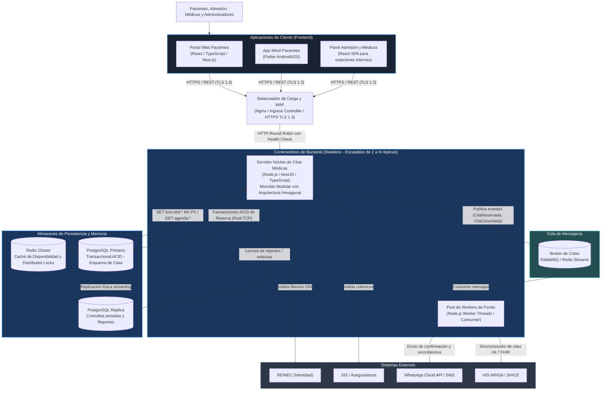

# Nivel 2 · Diagrama de Contenedores

> **Proyecto:** Sistema de Citas Médicas Escalable · Hospital de Huamanga  
> **Modelo:** C4 · Nivel 2 de 4

---

## 1. Objetivo

Abrir la caja del sistema de citas (Nivel 1) y detallar los **contenedores ejecutables**: aplicaciones frontend, servidores backend, balanceadores, motores de base de datos relacional, clúster de caché en memoria y colas de procesamiento asíncrono.

| Aspecto | Descripción |
| :--- | :--- |
| **Pregunta que responde** | ¿Cuáles son las piezas ejecutables del sistema de citas y cómo se comunican entre sí? |
| **Audiencia** | Arquitectos de software, desarrolladores, ingenieros DevOps y operaciones |
| **Nivel anterior** | [`Nivel1-DiagramadeContexto.md`](Nivel1-DiagramadeContexto.md) |
| **Siguiente nivel** | [`Nivel3-DiagramadeComponentes.md`](Nivel3-DiagramadeComponentes.md) |

---

## 2. Diagrama de Contenedores

---

## 3. Catálogo de Contenedores

| Contenedor | Tipo / Tecnología | Responsabilidad Principal | Persistencia / Estado |
| :--- | :--- | :--- | :--- |
| **Portal Web Pacientes** | SPA / SSR (React, Next.js, TailwindCSS) | Búsqueda accesible de especialidades, selección interactiva de horarios, confirmación de cita y check-in virtual con QR. | Solo estado en memoria del navegador del paciente. |
| **App Móvil Pacientes** | Nativo multiplataforma (Flutter) | Experiencia móvil optimizada con recordatorios push nativos y almacenamiento del comprobante offline. | SQLite local para credenciales y tokens JWT cifrados. |
| **Panel Admisión y Médicos** | SPA (React, Vite, Ant Design / Tailwind) | Interfaz interna rápida con atajos de teclado para admisión en ventanilla, gestión de sobrecupos y tablero del médico. | Solo estado de sesión en memoria. |
| **Balanceador de Carga & WAF** | Nginx / HAProxy / Cloud Load Balancer | Terminación SSL/TLS 1.3, rate limiting por IP para mitigar bots, balanceo entre réplicas del backend y monitoreo de salud (*health-checks*). | Sin estado (*Stateless*). |
| **Servidor Núcleo de Citas (Monolito)** | Proceso ejecutable (Node.js / NestJS / TypeScript) | Implementa la lógica de negocio modular: control de agenda, verificación de cupos, reserva atómica con distributed lock y API REST. | Sin estado (*Stateless*); puede escalar horizontalmente de 2 a 10 réplicas. |
| **Pool de Workers de Fondo** | Proceso consumidor (Node.js) | Procesa colas de mensajes en segundo plano: envío masivo de WhatsApp/SMS, generación de PDFs y sincronización HL7 FHIR. | Sin estado (*Stateless*). |
| **Broker de Colas** | RabbitMQ / Redis Streams | Encolamiento confiable con persistencia de mensajes en disco y colas de reintentos (*Dead Letter Queue* - DLQ). | Mensajes en tránsito almacenados en disco/memoria. |
| **Redis Clúster** | En memoria distribuido (Redis 7+) | Almacén de alta velocidad (< 10 ms) para catálogo de disponibilidad horaria y candados de exclusión mutua (*Distributed Locks*). | Memoria volátil con persistencia periódica AOF/RDB. |
| **PostgreSQL Primario** | Base de datos relacional (PostgreSQL 16) | Persistencia transaccional estricta (ACID) de citas, pacientes, turnos médicos, consultorios y tablas de auditoría inmutable. | Almacenamiento persistente en disco SSD NVMe con cifrado AES-256. |
| **PostgreSQL Réplica** | Base de datos relacional (Standby de solo lectura) | Atiende consultas pesadas de reportería, auditoría forense y analítica sin quitarle CPU al primario. | Réplica en tiempo real mediante *streaming replication*. |

---

## 4. Relaciones y Flujos de Comunicación

| Origen | Destino | Propósito del Flujo | Protocolo y Formato |
| :--- | :--- | :--- | :--- |
| Clientes Web / Móvil | Balanceador de Carga | Peticiones HTTP de usuarios | HTTPS / TLS 1.3 (JSON) |
| Balanceador | Servidor Monolito | Distribución balanceada de solicitudes | HTTP / REST interno |
| Servidor Monolito | Redis Clúster | Adquisición de Locks de cupo y lectura de disponibilidad en caché | Protocolo TCP RESP (Redis) |
| Servidor Monolito | PostgreSQL Primario | Creación atómica de citas y control transaccional | Conexión TCP nativa (Pool pg / ORM) |
| Servidor Monolito | Broker de Colas | Publicación de eventos de dominio (`CitaReservada`, `CitaCancelada`) | AMQP 0-9-1 / Redis Streams |
| Broker de Colas | Workers de Fondo | Consumo y procesamiento de tareas asíncronas | AMQP 0-9-1 / Redis Streams |
| Workers de Fondo | Pasarelas WhatsApp/SMS | Notificación al celular del paciente | HTTPS / REST |
| Servidor Monolito | RENIEC / SIS | Consulta de filiación y acreditación | HTTPS / REST |
