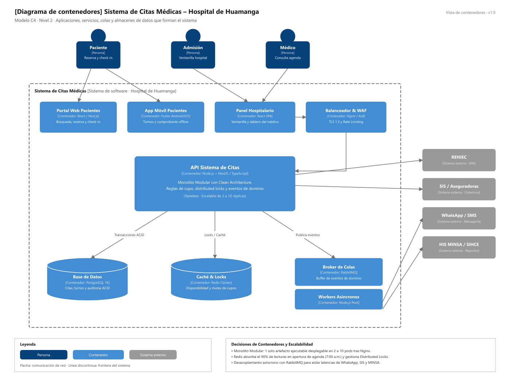

# Nivel 2 · Diagrama de Contenedores

> **Proyecto:** Sistema de Citas Médicas Escalable · Hospital de Huamanga  
> **Modelo:** C4 · Nivel 2 de 4 · **Versión:** 1.0

---

## 1. Objetivo

Abrir la caja «Sistema de Citas Médicas» del nivel 1 y mostrar los **contenedores ejecutables** que la forman: aplicaciones frontend, balanceador, API backend, broker de mensajería asíncrona, clúster de memoria y base de datos relacional.

| Aspecto | Descripción |
| :--- | :--- |
| **Pregunta que responde** | ¿De qué piezas ejecutables se compone el sistema y con qué tecnologías operan? |
| **Audiencia** | Arquitectos de software, desarrolladores, ingenieros DevOps y operaciones |
| **Qué es un contenedor** | Una unidad de software ejecutable o almacén de datos desplegable de forma independiente |
| **Nivel anterior** | [`Nivel1-DiagramadeContextodelSistema.md`](Nivel1-DiagramadeContextodelSistema.md) |
| **Siguiente nivel** | [`Nivel3-Diagrama-de-Componentes.md`](Nivel3-Diagrama-de-Componentes.md) |

---

## 2. Diagrama

---

## 3. Contenedores

| Contenedor | Tecnología | Responsabilidad | Datos que maneja |
| :--- | :--- | :--- | :--- |
| **Portal Web Pacientes** | SPA / SSR · React / Next.js | Interfaz de autoservicio para búsqueda de turnos libres, agendamiento web, reprogramación y check-in asistencial con QR. | Solo estado en memoria del navegador del paciente. |
| **App Móvil Pacientes** | Móvil · Flutter (Android / iOS) | Agendamiento desde dispositivos móviles con notificaciones push nativas y comprobante digital accesible sin conexión. | SQLite local para credenciales y tokens JWT cifrados. |
| **Panel Hospitalario** | SPA · React + Vite | Interfaz rápida con atajos de teclado para admisión en ventanilla, gestión de sobrecupos y tablero del médico. | Solo estado de sesión en memoria. |
| **Balanceador &amp; WAF** | Nginx / Cloud Load Balancer | Terminación SSL TLS 1.3, rate limiting por IP para mitigar bots, balanceo round-robin y health-checks continuos. | Sin estado (*Stateless*). |
| **API Sistema de Citas** | Node.js + NestJS / TypeScript | Monolito Modular con Clean Architecture. Expone `/api/v1/citas`, aplica reglas de negocio, gestiona candados distribuidos y publica eventos. | Sin estado (*Stateless*); escala de 2 a 10 réplicas según carga. |
| **Pool de Workers** | Node.js Consumer Threads | Procesa colas de mensajes en segundo plano: despacho de WhatsApp/SMS, generación de comprobantes y sincronización MINSA. | Sin estado (*Stateless*). |
| **Base de Datos** | PostgreSQL 16 Primario &amp; Réplica | Almacenamiento transaccional ACID de citas médicas, turnos, agendas, pacientes, consultorios y tablas de auditoría. | Esquema relacional completo de citas hospitalarias. |
| **Caché &amp; Locks** | Redis Clúster | Guarda en memoria el catálogo de disponibilidad (< 10 ms) y gestiona los Distributed Locks (`SET NX PX`) anti-doble reserva. | Copia temporal de slots y claves de exclusión mutua. |
| **Broker de Colas** | RabbitMQ / Redis Streams | Encolamiento confiable y desacoplamiento asíncrono para notificaciones y sincronizaciones con colas de reintentos (DLQ). | Mensajes y eventos de dominio en tránsito. |

---

## 4. Relaciones

| Origen | Destino | Descripción | Protocolo |
| :--- | :--- | :--- | :--- |
| Paciente, Admisión, Médico | Clientes Frontend | Usan el portal web, app móvil o panel hospitalario | HTTPS |
| Clientes Frontend | Balanceador &amp; WAF | Envían peticiones HTTP cifradas | HTTPS / TLS 1.3 (JSON) |
| Balanceador | API Sistema de Citas | Distribuye el tráfico a las réplicas del monolito | HTTP / REST interno |
| API Sistema de Citas | Base de Datos (PostgreSQL) | Lee y escribe información de citas y pacientes con ACID | SQL sobre TCP (Pool pg) |
| API Sistema de Citas | Caché &amp; Locks (Redis) | Adquiere candados distribuidos y lee disponibilidad | Protocolo RESP sobre TCP |
| API Sistema de Citas | Broker de Colas (RabbitMQ) | Publica eventos de dominio (`CitaReservada`, `CitaCancelada`) | AMQP 0-9-1 |
| Broker de Colas | Pool de Workers | Consume eventos y procesa tareas en background | AMQP 0-9-1 |
| Pool de Workers | Pasarela WhatsApp / SMS | Envía comprobantes y recordatorios al celular del paciente | HTTPS/REST |
| Pool de Workers | HIS MINSA / SIHCE | Reporta turnos y estadísticas hospitalarias | HTTPS / HL7 FHIR |
| API Sistema de Citas | RENIEC | Valida en línea DNI y nombres del paciente | HTTPS/REST (PIDE) |
| API Sistema de Citas | SIS / Aseguradoras | Verifica acreditación de cobertura médica | HTTPS/REST |

---

## 5. Decisiones Arquitectónicas Reflejadas

| Decisión | Alternativa Descartada | Motivo |
| :--- | :--- | :--- |
| **Un único contenedor backend (Monolito Modular)** | Microservicios distribuidos | Menor latencia de red en ráfagas de apertura (7:00 a. m.), consistencia estricta sin Sagas distribuidas y menor sobrecosto operativo (ADR-001). |
| **Redis para Locks Distribuidos y Caché de Cupos** | Consultar y bloquear directamente en PostgreSQL | Evita saturar el pool de conexiones de la base de datos durante picos de 5,000 usuarios concurrentes; garantiza cero citas duplicadas (ADR-003, ADR-004). |
| **Broker RabbitMQ para Notificaciones** | Enviar WhatsApp directamente en la petición HTTP | Las APIs de terceros tardan entre 1 y 3 segundos y pueden fallar; desacoplarlas mantiene la respuesta web por debajo de 500 ms (ADR-005). |
| **PostgreSQL con Réplica Streaming** | Base de datos NoSQL / MongoDB | La lógica médica de citas exige integridad relacional, llaves foráneas estrictas y soporte transaccional ACID probado (ADR-006). |

---

## 6. Seguridad entre Contenedores

| Comunicación | Medida de Seguridad |
| :--- | :--- |
| **Navegador / App Móvil → Balanceador y API** | Cifrado obligatorio TLS 1.3, cookies seguras `HttpOnly` y protección WAF contra ataques DDoS. |
| **Clientes Frontend → API** | Autenticación mediante tokens JWT firmados criptográficamente (algoritmo RS256) validados en cada solicitud. |
| **API → Base de Datos, Redis y RabbitMQ** | Aislamiento en red privada interna (VPC); credenciales inyectadas exclusivamente mediante variables de entorno secretas. |
| **API / Workers → Servicios Externos (RENIEC, SIS, Meta)** | Conexiones salientes HTTPS con mutual TLS o tokens API cifrados almacenados en el servidor. |
