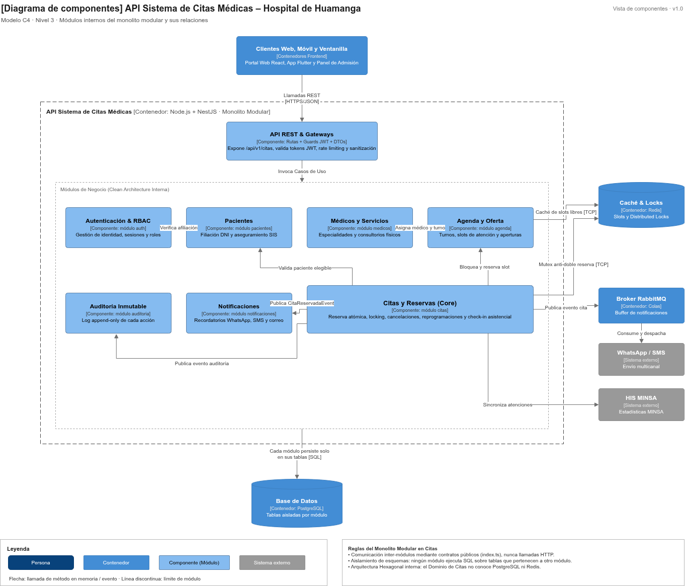

# Nivel 3 · Diagrama de Componentes

> **Proyecto:** Sistema de Citas Médicas Escalable · **Contenedor Detallado:** API Sistema de Citas Médicas  
> **Modelo:** C4 · Nivel 3 de 4 · **Versión:** 1.0

---

## 1. Objetivo

Abrir el contenedor **API Sistema de Citas Médicas** del nivel 2 y mostrar sus **componentes**: los módulos del monolito modular, la responsabilidad de cada uno y cómo colaboran entre sí, con la base de datos, la caché Redis, el broker de mensajería y los sistemas externos.

| Aspecto | Descripción |
| :--- | :--- |
| **Pregunta que responde** | ¿Cómo se divide el backend por dentro y qué hace cada módulo interno? |
| **Audiencia** | Arquitectos de software y desarrolladores backend |
| **Qué es un componente** | Un grupo cohesivo de funcionalidades con interfaces definidas (Puertos). En este proyecto, cada **módulo** del monolito modular es un componente |
| **Nivel anterior** | [`Nivel2-DiagramadeContenedores.md`](Nivel2-DiagramadeContenedores.md) |
| **Siguiente nivel** | [`Nivel4-DiagramadeCodigo.md`](Nivel4-DiagramadeCodigo.md) |

---

## 2. Diagrama

---

## 3. Componentes

| Componente | Responsabilidad | Funcionalidades Principales | Carpeta en el Código |
| :--- | :--- | :--- | :--- |
| **API REST &amp; Gateways** | Punto de entrada HTTP del contenedor | Expone rutas `/api/v1/citas`, valida tokens JWT, rate limiting y sanitización de DTOs | `src/api/` |
| **Autenticación &amp; RBAC** | Identidad y seguridad | Registro, inicio de sesión y validación de roles (Paciente, Admisión, Médico, Administrador) | `src/modulos/auth/` |
| **Pacientes** | Filiación y acreditación | Registro del padrón de pacientes, validación de DNI con RENIEC y consulta de seguro SIS | `src/modulos/pacientes/` |
| **Médicos y Servicios** | Catálogo asistencial | Gestión de especialidades médicas, profesionales de salud y consultorios físicos | `src/modulos/medicos/` |
| **Agenda y Oferta** | Programación médica | Generación de oferta médica mensual, cálculo de turnos/slots libres y calendarización de aperturas | `src/modulos/agenda/` |
| **Citas y Reservas (Core)** | Núcleo transaccional | Reserva atómica de citas con Distributed Lock, cancelación, reprogramación y check-in asistencial | `src/modulos/citas/` |
| **Notificaciones** | Mensajería al paciente | Construcción y despacho de plantillas WhatsApp/SMS para confirmación de reserva y recordatorios 24h antes | `src/modulos/notificaciones/` |
| **Auditoría Inmutable** | Trazabilidad forense | Registro append-only de cada creación, modificación, cancelación y check-in (IP, usuario y timestamp) | `src/modulos/auditoria/` |

---

## 4. Relaciones entre Componentes

| Origen | Destino | Descripción | Tipo de Comunicación |
| :--- | :--- | :--- | :--- |
| Clientes Frontend | API REST | Envían peticiones HTTP | HTTPS/JSON |
| API REST | Módulos de Negocio | Invoca los casos de uso respectivos | Llamada en memoria |
| Pacientes | Autenticación | Valida credenciales y permisos | Llamada en memoria (`index.ts`) |
| Agenda y Oferta | Médicos y Servicios | Asocia profesionales y consultorios a los turnos | Llamada en memoria |
| Citas y Reservas | Agenda y Oferta | Bloquea y actualiza el estado del cupo (slot) | Llamada en memoria |
| Citas y Reservas | Pacientes | Valida elegibilidad y afiliación al SIS | Llamada en memoria |
| Citas y Reservas | Notificaciones | Notifica la confirmación o cancelación de la cita | Evento de dominio en memoria / broker |
| Citas y Reservas | Auditoría | Publica evento inmutable de trazabilidad | Evento de dominio en memoria |

---

## 5. Relaciones con Contenedores y Sistemas Externos

| Componente | Destino | Descripción | Protocolo | Patrón Aplicado |
| :--- | :--- | :--- | :--- | :--- |
| Todos los módulos | Base de Datos (PostgreSQL) | Cada módulo lee y escribe **únicamente sus propias tablas** | SQL (TCP) | Repository |
| Agenda y Oferta | Caché (Redis) | Guarda y consulta el catálogo de turnos disponibles en memoria | TCP RESP | Decorator |
| Citas y Reservas | Locks Distribuidos (Redis) | Adquiere y libera candados atómicos de cupo (`SET NX PX`) | TCP RESP | Distributed Lock |
| Citas y Reservas | Broker (RabbitMQ) | Publica `CitaReservadaEvent` para procesamiento asíncrono | AMQP | Publish/Subscribe |
| Notificaciones | WhatsApp / SMS | Envía el comprobante digital al teléfono móvil del paciente | HTTPS/REST | Adapter |
| Citas y Reservas | HIS MINSA / SIHCE | Reporta atenciones y turnos programados | HTTPS / HL7 FHIR | Adapter |

---

## 6. Reglas del Monolito Modular

| # | Regla | Motivo |
| :--- | :--- | :--- |
| 1 | Todos los componentes se despliegan juntos en el contenedor API Sistema de Citas | Es un monolito modular: un único proceso en memoria y un único pipeline de despliegue simplificado. |
| 2 | Un módulo usa a otro exclusivamente a través de su API pública (`index.ts`) | Evita el acoplamiento cruzado y permite extraer cualquier módulo a microservicio en el futuro sin rediseñar el código. |
| 3 | Un módulo nunca lee ni escribe directamente en las tablas de base de datos de otro módulo | Mantiene la independencia estricta de datos de cada dominio. |
| 4 | Cada integración externa se encapsula dentro de un único adaptador | Si cambia el proveedor de SMS o la API del SIS, solo se modifica una clase concreta. |
| 5 | Cada módulo se organiza internamente bajo Clean Architecture | Las reglas clínicas no dependen de controladores ni bases de datos (ver Nivel 4). |
