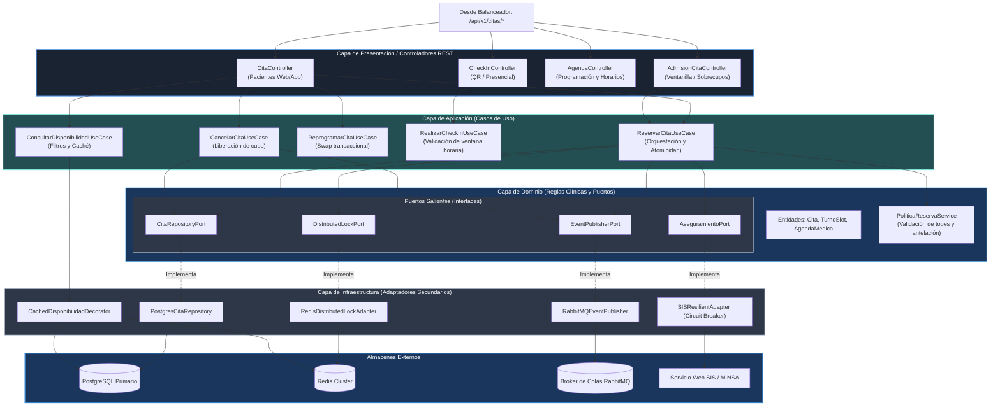

# Nivel 3 · Diagrama de Componentes

> **Proyecto:** Sistema de Citas Médicas Escalable · **Contenedor Detallado:** Servidor Núcleo de Citas Médicas  
> **Modelo:** C4 · Nivel 3 de 4

---

## 1. Objetivo

Abrir el contenedor **Servidor Núcleo de Citas Médicas** del nivel 2 y mostrar sus **componentes internos** organizados bajo la Arquitectura Hexagonal: controladores de entrada, casos de uso, servicios de dominio, entidades, puertos y adaptadores de infraestructura para base de datos, caché y mensajería.

| Aspecto | Descripción |
| :--- | :--- |
| **Pregunta que responde** | ¿Cómo se estructura internamente el servidor de citas y cómo colaboran sus piezas? |
| **Audiencia** | Arquitectos de software y desarrolladores backend |
| **Qué es un componente** | Un módulo funcional cohesivo con interfaces definidas (Puertos) y adaptadores concretos |
| **Nivel anterior** | [`Nivel2-DiagramadeContenedores.md`](Nivel2-DiagramadeContenedores.md) |
| **Siguiente nivel** | [`Nivel4-DiagramadeCodigo.md`](Nivel4-DiagramadeCodigo.md) |

---

## 2. Diagrama de Componentes

---

## 3. Catálogo de Componentes

| Componente | Capa | Responsabilidad | Funcionalidad Clave |
| :--- | :--- | :--- | :--- |
| `CitaController` | Presentación | Recibe solicitudes HTTP de pacientes (Web/Móvil) | Endpoints `/api/v1/citas` para consultar, reservar, reprogramar y cancelar. |
| `AdmisionCitaController` | Presentación | Endpoints optimizados para ventanilla hospitalaria | Registro rápido por DNI, sobrecupos autorizados y excepciones de turno. |
| `CheckInController` | Presentación | Valida asistencia del paciente | Endpoint para lectura de código QR de autoatención o ventanilla. |
| `ReservarCitaUseCase` | Aplicación | Orquesta la reserva asegurando atomicidad | Adquiere el lock en Redis, valida políticas, guarda en PostgreSQL y emite evento. |
| `ConsultarDisponibilidadUseCase` | Aplicación | Atiende consultas de oferta de turnos | Filtra cupos libres por médico/fecha interactuando con la caché de Redis. |
| `PoliticaReservaService` | Dominio | Evalúa reglas clínicas de negocio | Valida que el paciente no tenga citas duplicadas en el mes ni cruce de horarios. |
| `Entidades (Cita, Slot)` | Dominio | Encapsula el ciclo de vida y reglas de estado | Maneja transiciones de estado (`RESERVADA → CONFIRMADA → EN_SALA → ATENDIDA`). |
| `DistributedLockPort` | Dominio (Puerto) | Contrato de exclusión mutua | Define `adquirirLock(slotId)` y `liberarLock(slotId)`. |
| `RedisDistributedLockAdapter`| Infraestructura | Implementación concreta de candado | Ejecuta comandos atómicos en Redis para evitar doble agendamiento a nivel concurrente. |
| `CachedDisponibilidadDecorator`| Infraestructura | Decorator de consulta acelerada | Resuelve lecturas desde Redis en < 15 ms; ante fallo consulta la BD y calienta la caché. |
| `PostgresCitaRepository` | Infraestructura | Persistencia relacional de citas | Ejecuta transacciones SQL en PostgreSQL con aislamiento y control transaccional. |
| `SISResilientAdapter` | Infraestructura | Integración con aseguramiento SIS | Cliente HTTP protegido con Circuit Breaker y fallback en caso de indisponibilidad. |

---

## 4. Flujo de Interacción: Caso de Reserva Atómica

1. **Llegada de la Solicitud:** El `CitaController` valida el DTO de entrada (paciente, médico, cupo horario).
2. **Adquisición de Candado:** `ReservarCitaUseCase` invoca a `DistributedLockPort` (`RedisDistributedLockAdapter`), bloqueando el cupo por un máximo de 10 segundos. Si el cupo ya fue tomado en el mismo milisegundo por otro usuario, se rechaza inmediatamente con `HTTP 409 Conflict`.
3. **Validación de Dominio:** `PoliticaReservaService` verifica que el paciente no registre cruces de horario ni sobrepase la cantidad máxima de citas simultáneas del hospital.
4. **Persistencia Transaccional:** `PostgresCitaRepository` actualiza el estado del cupo a `RESERVADO` e inserta el registro de la cita en una transacción ACID.
5. **Liberación y Despacho:** Se libera el lock en Redis y se emite `CitaReservadaEvent` al `RabbitMQEventPublisher` para que el pool de workers envíe la confirmación por WhatsApp sin demorar la respuesta HTTP (< 500 ms).
