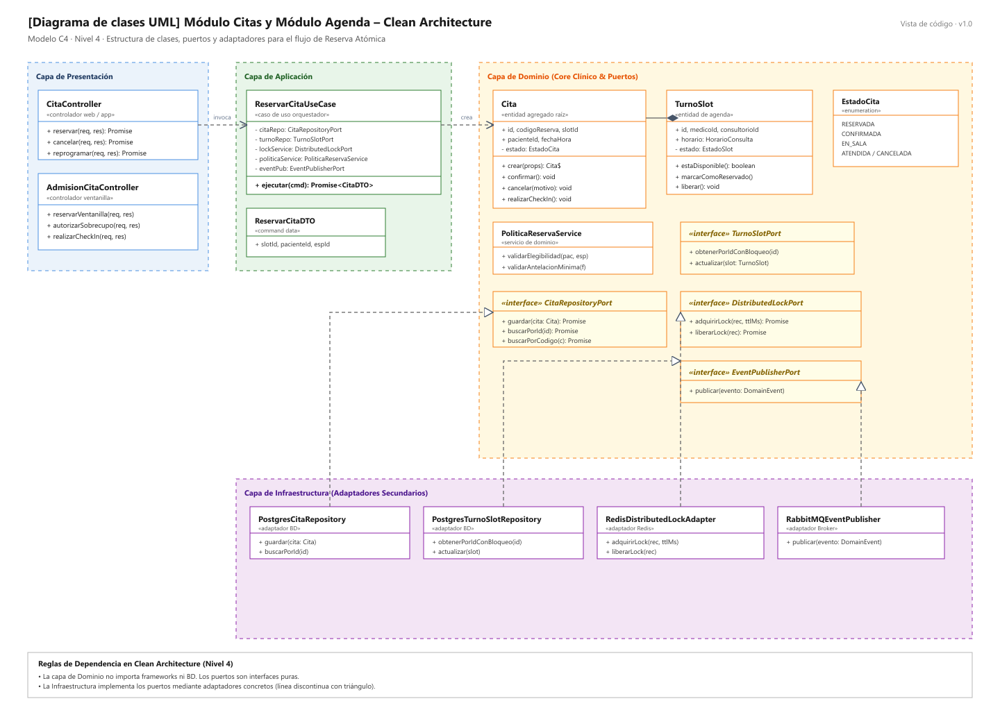
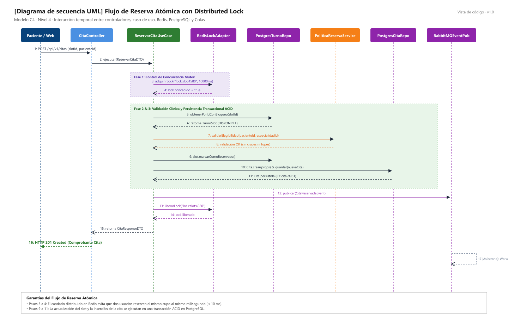

# Nivel 4 · Diagrama de Código

> **Proyecto:** Sistema de Citas Médicas Escalable · **Módulos Detallados:** Citas y Agenda  
> **Modelo:** C4 · Nivel 4 de 4 · **Notación:** UML · **Versión:** 1.0

---

## 1. Objetivo

Mostrar **cómo está organizado el código** de los componentes del nivel 3: sus clases, interfaces y cómo colaboran temporalmente. Se detalla el flujo de mayor impacto: **Reservar Cita Médica**, que involucra a los módulos **Citas** y **Agenda**, el bloqueo distribuido en Redis y la persistencia en PostgreSQL.

| Aspecto | Descripción |
| :--- | :--- |
| **Pregunta que responde** | ¿Qué clases existen dentro del módulo de citas y cómo colaboran en el tiempo? |
| **Audiencia** | Desarrolladores de software y evaluadores técnicos |
| **Notación** | UML (Diagrama de clases y Diagrama de secuencia). El modelo C4 recomienda UML para este nivel |
| **Por qué estos dos módulos** | El nivel 4 es opcional en C4 y se dibuja solo para los módulos más críticos. Citas y Agenda concentran las reglas de negocio de cupos, el control de concurrencia y las integraciones |
| **Nivel anterior** | [`Nivel3-Diagrama-de-Componentes.md`](Nivel3-Diagrama-de-Componentes.md) |

---

## 2. Diagrama de Clases

### 2.1 Capas de Clean Architecture

| Capa | Contiene | Regla |
| :--- | :--- | :--- |
| **Presentación** | `CitaController`, `AdmisionCitaController` | Traduce peticiones HTTP a llamadas de casos de uso y viceversa. |
| **Aplicación** | `ReservarCitaUseCase`, `ReservarCitaDTO` | Coordina los pasos de la reserva; no conoce librerías de infraestructura. |
| **Dominio** | `Cita`, `TurnoSlot`, `PoliticaReservaService`, Puertos | Contiene las reglas del hospital; no importa nada de las capas externas. |
| **Infraestructura** | Repositorios (`Postgres*`), Adaptador Redis, Broker | Implementa las interfaces del dominio con tecnologías concretas. |

> **Regla de Dependencia:** Las flechas del código apuntan hacia el Dominio. Las clases de infraestructura implementan interfaces del dominio (triángulo hueco); el dominio nunca conoce a la infraestructura.

### 2.2 Clases del Módulo Citas

| Clase | Tipo | Capa | Responsabilidad |
| :--- | :--- | :--- | :--- |
| `CitaController` | Controlador | Presentación | Recibe `POST /api/v1/citas` de la web/app y responde al paciente. |
| `AdmisionCitaController` | Controlador | Presentación | Gestiona citas presenciales en ventanilla y autoriza sobrecupos. |
| `ReservarCitaUseCase` | Caso de uso | Aplicación | Orquesta la adquisición del lock en Redis, valida reglas, persiste en PostgreSQL y emite eventos. |
| `Cita` | Entidad (Agregado Raíz) | Dominio | Aplica las reglas de estado de la cita (`RESERVADA → CONFIRMADA → EN_SALA → ATENDIDA`). |
| `PoliticaReservaService` | Servicio de Dominio | Dominio | Valida que el paciente no registre cruces de horario ni sobrepase topes mensuales. |
| `CitaRepositoryPort` | Interfaz (Puerto) | Dominio | Contrato abstracto para guardar y consultar citas médicas. |
| `DistributedLockPort` | Interfaz (Puerto) | Dominio | Contrato abstracto para adquirir y liberar candados de cupo. |
| `PostgresCitaRepository` | Repositorio | Infraestructura | Implementa `CitaRepositoryPort` ejecutando transacciones SQL en PostgreSQL. |
| `RedisDistributedLockAdapter`| Adaptador | Infraestructura | Implementa `DistributedLockPort` mediante comandos atómicos `SET NX PX` en Redis. |

### 2.3 Clases del Módulo Agenda

| Clase | Tipo | Capa | Responsabilidad |
| :--- | :--- | :--- | :--- |
| `TurnoSlot` | Entidad | Dominio | Modela el cupo de atención con médico, horario y consultorio; controla su disponibilidad. |
| `TurnoSlotPort` | Interfaz (Puerto) | Dominio | Contrato para consultar y actualizar el estado del cupo con soporte de bloqueo SQL. |
| `PostgresTurnoSlotRepository`| Repositorio | Infraestructura | Implementa `TurnoSlotPort` con `SELECT ... FOR UPDATE` en PostgreSQL. |

### 2.4 Notación UML Utilizada

| Símbolo | Significado | Ejemplo en el diagrama |
| :--- | :--- | :--- |
| Línea continua con flecha abierta | Asociación: la clase tiene una referencia a la otra | `ReservarCitaUseCase` → `CitaRepositoryPort` |
| Línea discontinua con flecha abierta | Dependencia: la usa o la crea | `ReservarCitaUseCase` «crea» `Cita` |
| Línea discontinua con triángulo hueco | Realización: implementa una interfaz | `PostgresCitaRepository` ▷ `CitaRepositoryPort` |
| Rombo relleno | Composición: la parte no existe sin el todo | `Cita` ◆ `CodigoReserva` |
| Nombre en cursiva con «interface» | Interfaz (contrato sin implementación) | `DistributedLockPort` |
| `-` y `+` | Atributo o método privado y público | `- estado`, `+ confirmar()` |

---

## 3. Diagrama de Secuencia: Flujo de Reserva Atómica

| Paso | Origen → Destino | Acción Realizada |
| :--- | :--- | :--- |
| 1 | Paciente Web → `CitaController` | Envía `POST /api/v1/citas` con `slotId`, `pacienteId` y `especialidadId`. |
| 2 | `CitaController` → `ReservarCitaUseCase` | Ejecuta el caso de uso con los datos validados. |
| 3–4 | `ReservarCitaUseCase` → `RedisLockAdapter` | Solicita candado distribuido `lock:slot:4580` por 10 segundos. Redis responde `true` (concedido). Si estuviera ocupado, rechaza inmediatamente con `409 Conflict`. |
| 5–6 | `ReservarCitaUseCase` → `PostgresTurnoRepo` | Consulta el cupo con bloqueo pesimista en base de datos; retorna `TurnoSlot (DISPONIBLE)`. |
| 7–8 | `ReservarCitaUseCase` → `PoliticaReservaService` | Valida reglas clínicas (sin cruce de turnos ni límite mensual excedido). |
| 9 | `ReservarCitaUseCase` → `TurnoSlot` | Marca el cupo como `RESERVADO`. |
| 10–11 | `ReservarCitaUseCase` → `PostgresCitaRepo` | Crea y guarda la entidad `Cita` en PostgreSQL bajo transacción ACID. |
| 12 | `ReservarCitaUseCase` → `RabbitMQEventPub` | Publica `CitaReservadaEvent` en la cola de mensajería. |
| 13–14 | `ReservarCitaUseCase` → `RedisLockAdapter` | Libera el candado distribuido de Redis. |
| 15–16 | `CitaController` → Paciente Web | Responde `201 Created` con el número y comprobante de reserva (< 500 ms). |
| 17 | `RabbitMQEventPub` → Workers | En segundo plano, los workers consumen el evento y despachan el WhatsApp al paciente. |

---

## 4. Patrones y Principios que se ven en este Nivel

| Elemento del Diagrama | Patrón o Principio Aplicado |
| :--- | :--- |
| `PostgresCitaRepository ▷ CitaRepositoryPort` | Patrón **Repository** y Principio de **Inversión de Dependencias (DIP)**. |
| `RedisDistributedLockAdapter ▷ DistributedLockPort` | Patrón **Distributed Lock (Mutex)** para prevenir condiciones de carrera. |
| `RabbitMQEventPublisher ▷ EventPublisherPort` | Patrón **Publish/Subscribe** para desacoplamiento asíncrono. |
| `ReservarCitaUseCase` depende solo de interfaces | Principio de **Inversión de Dependencias (DIP)** y **Clean Architecture**. |
