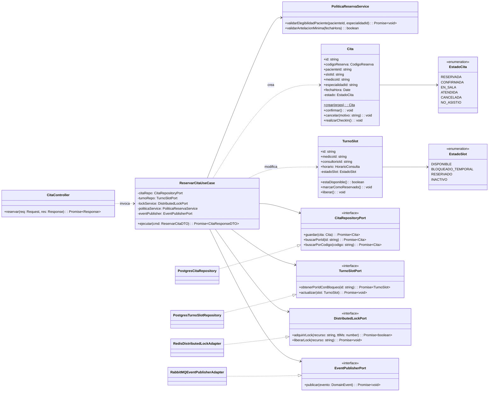
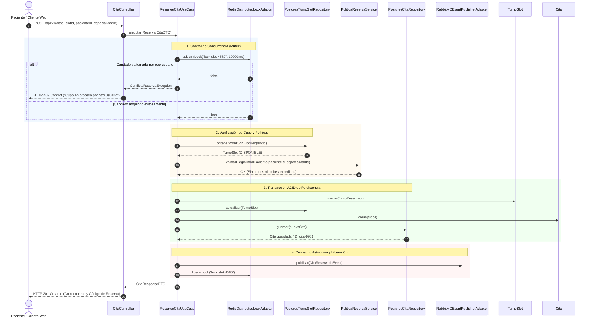

# Nivel 4 · Diagrama de Código

> **Proyecto:** Sistema de Citas Médicas Escalable · Hospital de Huamanga  
> **Modelo:** C4 · Nivel 4 de 4 · **Notación:** Diagrama de Clases UML  
> **Flujo Detallado:** Reservar Cita Médica con Control de Concurrencia y Bloqueo Distribuido

---

## 1. Objetivo

Mostrar la **organización detallada del código orientado a objetos**: clases, interfaces, métodos y cómo colaboran en el flujo de mayor criticidad del sistema: **Reservar Cita Médica**. Este flujo garantiza la atomicidad y la prevención absoluta de doble agendamiento (*race conditions*) bajo alta concurrencia.

| Aspecto | Descripción |
| :--- | :--- |
| **Pregunta que responde** | ¿Cuáles son las clases, métodos y relaciones exactas que ejecutan la reserva de citas? |
| **Audiencia** | Desarrolladores de software y evaluadores técnicos |
| **Nivel anterior** | [`Nivel3-DiagramadeComponentes.md`](Nivel3-DiagramadeComponentes.md) |
| **Detalle de implementación** | [`diseño-interno-de-modulos.md`](../03-diseño-de-software/diseño-interno/diseño-interno-de-modulos.md) |

---

## 2. Diagrama de Clases (UML)

---

## 3. Catálogo de Clases e Interfaces

| Elemento | Capa | Tipo | Responsabilidad |
| :--- | :--- | :--- | :--- |
| `CitaController` | Presentación | Clase | Maneja la petición HTTP `POST /api/v1/citas`, valida el esquema del cuerpo con DTOs y retorna `201 Created` o `409 Conflict`. |
| `ReservarCitaUseCase` | Aplicación | Clase | Orquesta de manera secuencial y segura el flujo de reserva (adquisición del lock, validaciones de dominio, persistencia transaccional y publicación de evento). |
| `PoliticaReservaService` | Dominio | Servicio de Dominio | Encapsula reglas de negocio complejas del hospital (máximo de citas activas por paciente en el mes, restricciones de cruce de horario). |
| `Cita` | Dominio | Entidad Raíz de Agregado | Protege los invariantes del ciclo de vida de la cita, asigna el código único y gestiona las transiciones válidas de estado. |
| `TurnoSlot` | Dominio | Entidad | Representa el cupo físico/temporal en un consultorio específico con un médico; garantiza que no se reserve si no está disponible. |
| `EstadoCita` | Dominio | Enumeración | Define los estados posibles: `RESERVADA`, `CONFIRMADA`, `EN_SALA`, `ATENDIDA`, `CANCELADA`, `NO_ASISTIO`. |
| `CitaRepositoryPort` | Dominio | Interfaz | Contrato abstracto para guardar y consultar citas sin acoplarse al driver de base de datos. |
| `TurnoSlotPort` | Dominio | Interfaz | Contrato para la lectura y actualización de cupos con soporte de bloqueo pesimista en SQL (`SELECT FOR UPDATE`). |
| `DistributedLockPort` | Dominio | Interfaz | Contrato de candado distribuido para sincronización concurrente entre múltiples instancias de backend. |
| `EventPublisherPort` | Dominio | Interfaz | Contrato para publicar eventos de dominio (`CitaReservadaEvent`). |
| `PostgresCitaRepository` | Infraestructura | Adaptador | Implementa `CitaRepositoryPort` utilizando transacciones ACID en PostgreSQL. |
| `RedisDistributedLockAdapter` | Infraestructura | Adaptador | Implementa `DistributedLockPort` ejecutando primitivas atómicas en Redis (`SET NX PX`). |
| `RabbitMQEventPublisherAdapter`| Infraestructura | Adaptador | Implementa `EventPublisherPort` publicando el evento al broker de mensajería para el envío de notificaciones. |

---

## 4. Diagrama de Secuencia del Flujo de Reserva

---

## 5. Reglas de Implementación en Código

1. **Aislamiento Absoluto de Dominio:** Ninguna clase dentro de `dominio/` puede importar librerías de infraestructura como TypeORM, Prisma, Redis o Express.
2. **Atomicidad:** La actualización del `TurnoSlot` y el guardado de la `Cita` se ejecutan dentro del mismo bloque de transacción de base de datos. Si una falla, se hace rollback automático de ambas.
3. **Liberación Garantizada del Candado:** La llamada a `liberarLock` reside dentro de un bloque `finally`, garantizando que el cupo nunca quede bloqueado indefinidamente aun si ocurre una excepción imprevista.
